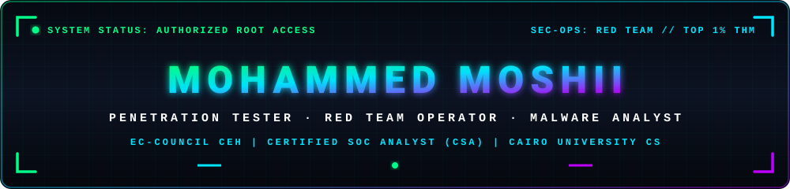
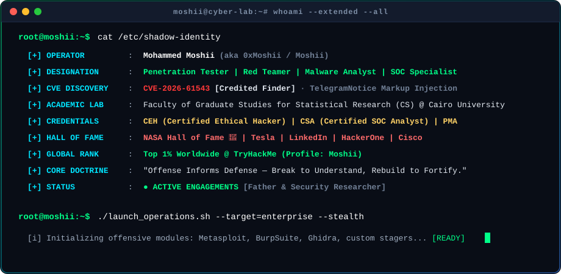
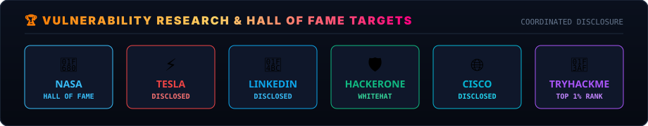
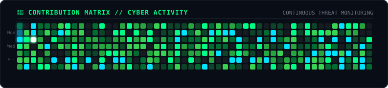

  

<pre align="center">
   ███╗   ███╗ ██████╗ ███████╗██╗  ██╗██╗██╗
   ████╗ ████║██╔═══██╗██╔════╝██║  ██║██║██║
   ██╔████╔██║██║   ██║███████╗███████║██║██║
   ██║╚██╔╝██║██║   ██║╚════██║██╔══██║██║██║
   ██║ ╚═╝ ██║╚██████╔╝███████║██║  ██║██║██║
   ╚═╝     ╚═╝ ╚═════╝ ╚══════╝╚═╝  ╚═╝╚═╝╚═╝
</pre>

  

  
  
  
  
  
  
  
  

  <a href="https://mohammed-moshii.github.io"><b>🌐 Official Portfolio</b></a> •
  <a href="https://www.linkedin.com/in/mohammed-m0shii/"><b>💼 LinkedIn</b></a> •
  <a href="https://tryhackme.com/p/Moshii"><b>🎯 TryHackMe</b></a> •
  <a href="https://www.youtube.com/@moshii0x00"><b>📺 YouTube</b></a> •
  <a href="https://github.com/mohammed-moshii"><b>🐙 GitHub</b></a>

---

### ⚡ SYSTEM IDENTIFICATION // WHOAMI

  

> *"Offense informs defense. I dissect complex architectures, uncover 0-day attack surfaces, reverse engineer hostile payloads, and fortify enterprise perimeters against advanced threat actors."*

- 🛡️ **CVE Discovery** : Officially credited **Finder & Author** of [**CVE-2026-61543**](https://github.com/mifasu/telegramnotice/security/advisories/GHSA-9hc4-rm53-6f97) (*GHSA-9hc4-rm53-6f97*) — HTML/Markup Injection in TelegramNotice message formatting.
- 👨‍👦 **Who am I** : Proud **Father** | **Penetration Tester** | **Red Teamer / Hacker** | **SOC Analyst** | **Malware Analyst**.
- 🎓 **Academic Research** : Graduate Student in **Computer Science** at the [Faculty of Graduate Studies for Statistical Research (FGSSR / CSDS)](https://csds.cu.edu.eg), Cairo University.
- 📜 **Accreditations** : **CEH** (Certified Ethical Hacker) • **CSA** (Certified SOC Analyst) • **PMA** (Practical Malware Analysis).
- 🏆 **Major Milestones** : Honored in the official **NASA Hall of Fame** for responsible vulnerability disclosure.

---

### 🏆 VULNERABILITY RESEARCH & HALL OF FAME TARGETS

  

 

| Target Entity | Status &amp; Impact | Research Focus |
| :--- | :--- | :--- |
| 🛡️ [**CVE-2026-61543**](https://github.com/mifasu/telegramnotice/security/advisories/GHSA-9hc4-rm53-6f97) | **Discovered &amp; Credited (Finder)** | HTML Injection in TelegramNotice formatting ([GHSA-9hc4-rm53-6f97](https://github.com/mifasu/telegramnotice/security/advisories/GHSA-9hc4-rm53-6f97)) |
| 🚀 **NASA** | **Hall of Fame Inductee** | Coordinated security disclosure via NASA VDP |
| ⚡ **Tesla** | **Disclosed &amp; Remediated** | Bug bounty &amp; product perimeter security |
| 💼 **LinkedIn** | **Disclosed &amp; Remediated** | Enterprise identity &amp; web application vulnerabilities |
| 🛡️ **HackerOne** | **Active Whitehat** | Responsible vulnerability reports on global bug bounties |
| 🌐 **Cisco** | **Disclosed &amp; Acknowledged** | Network appliance &amp; protocol vulnerability discovery |
| 🎯 **TryHackMe / HTB** | **Top 1% Worldwide** | Pro Labs pwnage, Active Directory exploitation, CTF challenges |

---

### ⚔️ OFFENSIVE ARSENAL &amp; SECURITY CAPABILITIES

  

 

<table>
  <tr>
    <td width="30%" valign="top"><b>🚩 Offensive Security &amp; Red Team</b></td>
    <td width="70%">
      
      
      
      
      
      
      
      
      
    </td>
  </tr>
  <tr>
    <td width="30%" valign="top"><b>🔬 Reverse Engineering &amp; Malware</b></td>
    <td width="70%">
      
      
      
      
      
      
      
    </td>
  </tr>
  <tr>
    <td width="30%" valign="top"><b>🛡️ SOC &amp; Threat Operations</b></td>
    <td width="70%">
      
      
      
      
      
      
    </td>
  </tr>
  <tr>
    <td width="30%" valign="top"><b>💻 Exploit Dev &amp; Scripting</b></td>
    <td width="70%">
      
      
      
      
      
      
    </td>
  </tr>
  <tr>
    <td width="30%" valign="top"><b>⚙️ Infrastructure &amp; Lab</b></td>
    <td width="70%">
      
      
      
      
      
    </td>
  </tr>
</table>

---

### 🔬 FEATURED SECURITY PROJECTS &amp; EXPLOITS

<table>
  <tr>
    <td width="50%">
      <h3><a href="https://github.com/mohammed-moshii/CVE-2023-34468-Apache-NiFi-RCE">⚡ CVE-2023-34468: Apache NiFi RCE</a></h3>
      
Weaponized remote code execution exploit for Apache NiFi 1.21.0 utilizing the <code>ExecuteProcess</code> processor variant. Features automated JWT session extraction, CSRF header token bypass, and persistent reverse shell stagers.

      
      
    </td>
    <td width="50%">
      <h3><a href="https://github.com/mohammed-moshii/moshii-PrivEsc">🔑 moshii-PrivEsc</a></h3>
      
Automated post-exploitation and privilege escalation suite for Windows environments. Provides comprehensive enumeration checklists, service misconfiguration scanning, token manipulation, and UAC bypass vectors.

      
      
    </td>
  </tr>
  <tr>
    <td width="50%">
      <h3><a href="https://github.com/mohammed-moshii/moshii-GPT">🤖 MoshiiGPT — AI CyberShell Assistant</a></h3>
      
Next-gen AI cybersecurity terminal assistant combining OpenAI, DeepSeek, Together AI &amp; VirusTotal. Features automated OSINT reconnaissance, real-time packet capturing with tcpdump, threat intelligence, and smart interactive penetration testing workflows.

      
      
      
      
    </td>
    <td width="50%">
      <h3><a href="https://github.com/mifasu/telegramnotice/security/advisories/GHSA-9hc4-rm53-6f97">🛡️ CVE-2026-61543: TelegramNotice HTML Injection</a></h3>
      
Discovered by Mohammed Moshii (Finder). Vulnerability in TelegramNotice allowing user-controlled input insertion into Telegram HTML messages without proper sanitization, enabling markup breakout and phishing link injection.

      
      
      
    </td>
  </tr>
</table>

---

### 📊 CYBER METRICS &amp; TELEMETRY

  

 

  

---

### 📡 SECURE TRANSMISSION CHANNELS

&nbsp;

&nbsp;

&nbsp;

&nbsp;

  

⚡ <b>MOHAMMED MOSHII</b> · OFFENSIVE CYBER SECURITY RESEARCHER · ALL SYSTEMS OPERATIONAL ⚡

